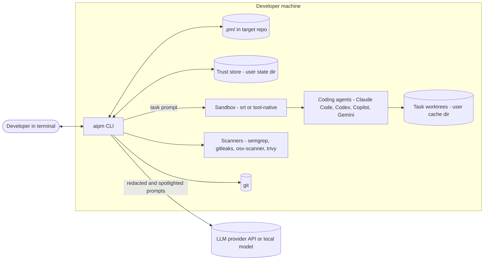
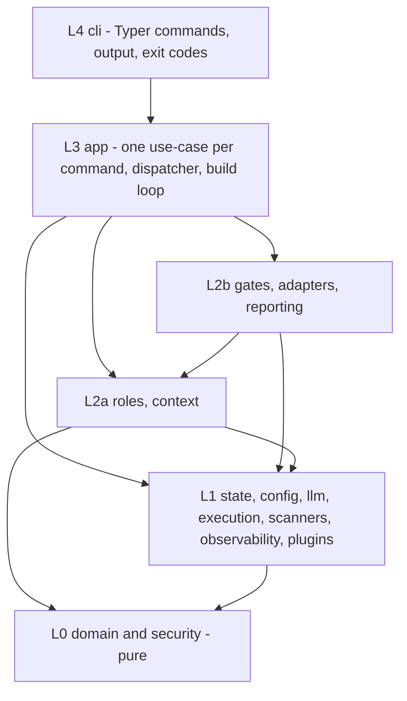
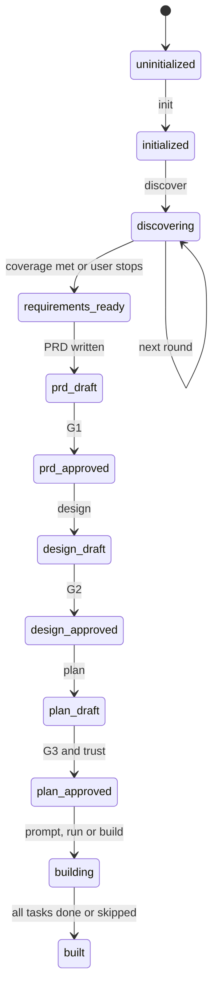
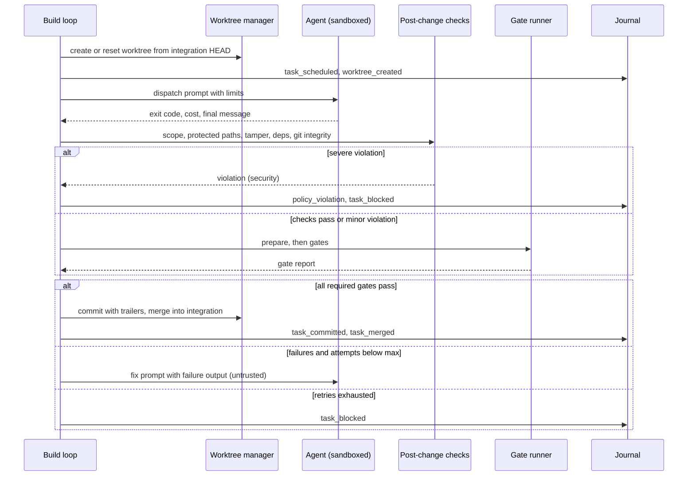

# aipm architecture

| | |
|---|---|
| Status | Design v1.0, approved for the v0.1 build |
| Date | 2026-10-28 |
| Owner | Balakrishnan ([@mlbala](https://github.com/mlbala)) |
| Repo | `github.com/mlbala/aipm` (GitHub-only distribution, no PyPI) |
| Companion | [SECURITY.md](SECURITY.md): threat model and security controls. It is normative: where the two documents overlap, SECURITY.md wins. |

The words MUST, SHOULD and MAY are used as in RFC 2119. Section numbers (§) are stable; build prompts refer to them.

---

## 1. Summary

`aipm` is a terminal-first AI product manager and tech lead. In any project folder, it:

1. interviews the user until requirements are complete,
2. writes the PRD, architecture, ADRs and threat model,
3. splits the work into a dependency graph of agent-sized tasks,
4. compiles one prompt per task for the user's coding agent (Claude Code, Codex CLI, GitHub Copilot CLI, Gemini CLI),
5. generates `AGENTS.md` and per-tool context files,
6. optionally dispatches tasks to those agents, one at a time or in parallel,
7. marks a task done only when deterministic gates pass,
8. keeps a worksheet of what is done, in progress, blocked and to do.

All project state is plain files in `.pm/` inside the target repo.

Three properties separate aipm from prompt packs such as GitHub Spec Kit and BMAD-METHOD:

- **External controller.** aipm runs outside the coding agent. It owns the plan, the context and the verdict. Agents are interchangeable workers.
- **Deterministic "done".** Tests, linters, type checkers and scanners decide whether a task is done. An LLM can veto a task but can never pass one.
- **Security by construction.**
  - aipm's own LLM calls have no tools; their output is data validated against schemas.
  - The LLM never writes a command that aipm executes; it chooses from a menu.
  - Execution trust lives outside the repo, so a cloned repo cannot grant itself permissions.

## 2. Scope

### 2.1 Goals

- **G-1** Take a project from idea to merged, verified code with the human approving at three gates.
- **G-2** Work with any of the four supported coding agents through one canonical task format.
- **G-3** Give full manual control (one command per step) and full automation (`aipm build`, `aipm auto`) over the same state.
- **G-4** Resist prompt injection from every untrusted source: idea files, repo content, LLM output, agent output, and tool output.
- **G-5** Resume after any interruption without losing state or duplicating work.
- **G-6** Install from GitHub with one command; no PyPI.

### 2.2 Non-goals (v1)

- aipm does not write application code itself.
- aipm does not push to remotes, open PRs or deploy. It produces verified commits on a local branch.
- No IDE plugin and no web UI.
- No native Windows support (WSL is documented instead).
- One `.pm/` per repository root; no monorepo sub-projects.
- No RAG or vector store over the codebase. Context is a repo map plus explicitly listed files.

### 2.3 Personas

| Persona | Needs | Typical mode |
|---|---|---|
| Solo builder | Turn an idea into a working MVP quickly without losing control | `discover` → `design` → `plan` → `build` |
| Tech lead | Consistent specs, prompts and verification across agents | Manual: `prompt` + `verify` |
| Contributor in an existing repo (brownfield) | Add one feature with guardrails | `init` → `discover --from issue.md` → `plan` |
| CI pipeline | Non-interactive verification and context drift checks | `verify --json`, `sync-context --check` |

### 2.4 Prior art

| Project | What it does | What aipm borrows | Where aipm differs |
|---|---|---|---|
| GitHub Spec Kit | Spec → plan → tasks → implement, as slash commands inside the agent | Spec-first flow, multi-agent support, `uv`-based install from git | Runs outside the agent, enforces gates, dispatches and verifies |
| BMAD-METHOD | Persona agents (Analyst, PM, Architect, ...) inside the IDE | Role separation, human-in-the-loop document review | One central state in `.pm/`, deterministic verification, security harness |

aipm does not depend on either project.

## 3. Principles

These are referenced as P-n throughout. Each maps to controls in §6–§13 and in [SECURITY.md](SECURITY.md).

| # | Principle |
|---|---|
| P-1 | aipm never writes application code. It writes only `.pm/`, context files (inside managed blocks) and generated skills. |
| P-2 | `.pm/` files are the single source of truth. They are human-readable, diffable and validated on every load. The current phase is derived from these files and is never stored separately. |
| P-3 | Every step is a separate command. `build` and `auto` only chain those commands. Manual and automatic use can be mixed at any time. |
| P-4 | Discovery runs in rounds against a fixed coverage checklist. A skipped question becomes a written assumption, never a silent guess. |
| P-5 | Each task is stored once in a tool-neutral form; adapters render it for each tool. `AGENTS.md` is the shared context file, and tool-specific files are thin and point to it. |
| P-6 | Only deterministic gates mark a task done. An LLM review can veto but cannot approve. |
| P-7 | Security is applied twice: at design time (a threat model, whose mitigations become tasks) and at verify time (scanners). |
| P-8 | Parallel work comes from a task DAG with exclusive file ownership. Tasks whose ownership overlaps are merged or run one after another. |
| P-9 | Humans approve at G1 (PRD), G2 (design) and G3 (plan). `--yes` skips these review gates; nothing skips a security policy check. |
| P-10 | With `dispatch.enabled: false`, aipm never launches a coding agent. |
| P-11 | `status`, `scan`, `verify` (without the AC review), `sync-context`, `prompt`, `trust` and `doctor` work with no LLM configured. |
| P-12 | aipm's LLM roles have no tools. Their output is data, never code, never commands. |
| P-13 | Execution trust is stored per user and per machine, outside the repo. |
| P-14 | Fail closed. If a required safety capability is missing (a sandbox, a permission flag, a schema), aipm refuses the action and explains why. |

## 4. System context



External dependencies:

- **Required:** git 2.40+ and Python 3.13+ (via `uv`; [ADR-0015](adr/0015-python-3-13-or-later.md)).
- **Optional:**
  - The coding agent CLIs.
  - The scanners.
  - `srt`, the Anthropic sandbox runtime, installed with `npm i -g @anthropic-ai/sandbox-runtime`.
  - An LLM API key, or an OpenAI-compatible local server such as Ollama.

## 5. Logical architecture

### 5.1 Layers



**Dependency rules.** These are enforced in CI with `import-linter` and ruff:

- A layer may import only from layers below it. L2 has two sub-layers: L2b (`gates`, `adapters`, `reporting`) may import L2a (`roles`, `context`), so `gates → roles` (the AC reviewer) and `adapters → context` (context files) are legal. Packages inside L2a, and inside L2b, are independent of each other. Packages inside L0, and inside L1, may import each other.
- `cli` may import only `aipm.app`, `aipm.domain.errors` (the exit codes and error types) and `aipm.security.sanitize` (to clean text before printing), plus `cli`'s own output helpers.
- L0 is pure: no subprocess, no network, no file writes, no LLM SDKs. It imports only the standard library and `pydantic`, and MUST NOT import `subprocess`, `socket`, `httpx`, `anthropic`, `openai`, the `os.system` family, or file I/O helpers. The one exception is `security/paths.py`, which may make read-only `lstat`/`realpath` calls to detect symlink escapes.
- A process can be started from exactly one module, `aipm.execution.process`. A ruff `banned-api` list (TID251) applies to `src/aipm/**` and bans `subprocess`, `os.system`, `os.popen`, `os.spawn*`, `os.exec*`, `os.posix_spawn*`, `os.fork`, `os.forkpty`, `pty`, `multiprocessing`, `asyncio.create_subprocess_exec`, `asyncio.create_subprocess_shell`, `importlib.import_module` and the `builtins` module. ruff cannot see the bare `__import__` builtin or the `__builtins__` name, so a test in `tests/security` scans every module for them. `execution/process.py` is the only exemption, except that `plugins/loader.py` may call `importlib.import_module` once entry-point loading arrives (v0.4). import-linter forbids the `subprocess` import as a second layer; it sees module imports only, not attribute calls such as `os.system`.
- Network access exists in exactly two places: the LLM gateway (`aipm.llm`) and the registry lookups in `aipm.scanners.registry`.
- LLM SDKs are imported only inside `aipm.llm.providers.*`, and lazily (at call time, not at module import), to keep CLI startup fast.

### 5.2 Components

| # | Component | Package | Responsibility | Milestone |
|---|---|---|---|---|
| C-1 | CLI layer | `aipm.cli` | Parse commands, global flags, render Rich or JSON output, map errors to exit codes. The error types and the `ExitCode` enum live in `aipm.domain.errors`. | v0.1 |
| C-2 | Config manager | `aipm.config` | Merge config layers, enforce the key classes (§15), validate the schema, load stack templates | v0.1 |
| C-3 | State store | `aipm.state` | `.pm/` I/O: atomic writes, lock, deterministic YAML, front matter, schema validation, security events. Schema migrations come with the first v2 schema (§6.2). | v0.1 |
| C-4 | Phase engine | `aipm.domain.phase` | Derive the phase from files, detect staleness, decide the next step | v0.1 |
| C-5 | LLM gateway | `aipm.llm` | Providers, role→model routing, structured output, retries, cost accounting, redaction; response cache | v0.1 (cache in v0.2) |
| C-6 | LLM roles | `aipm.roles` | Interviewer, PRD writer, architect, threat modeler, planner, AC reviewer. All are tool-less. | v0.1 (AC reviewer in v0.2) |
| C-7 | Coverage engine | `aipm.domain.coverage` | Checklist scoring, assumptions, open questions, stop rule | v0.1 |
| C-8 | Plan validator | `aipm.domain.dag` | Acyclicity, ownership overlap, gate-menu validation, size caps | v0.1 |
| C-9 | Prompt compiler | `aipm.adapters.compiler` | Canonical `TaskSpec` → tool-specific prompt (no LLM) | v0.1 |
| C-10 | Context generator | `aipm.context` | `AGENTS.md`, `CLAUDE.md`, `GEMINI.md`, Copilot instructions, skills, subagents | v0.1 (`AGENTS.md`, `CLAUDE.md`); v0.2 (Claude subagents and skills); other tools in v0.4 |
| C-11 | Tool adapters | `aipm.adapters` | Per-tool rendering, capability detection, headless invocation, output parsing | Claude Code: v0.1 render, v0.3 dispatch; Codex, Copilot, Gemini: v0.4 |
| C-12 | Process runner | `aipm.execution.process` | The only subprocess entry point: argv only, timeouts, env allowlist, output caps, process-group kill | v0.1 |
| C-13 | Sandbox | `aipm.execution.sandbox` | Wrap a process in `srt` or a tool-native sandbox, with network profiles | v0.2 |
| C-14 | Git and worktrees | `aipm.execution.git`, `aipm.execution.worktree` | Safe git calls (hooks off), worktrees, integration branch, integrity checks | v0.2 (git), v0.3 (worktrees) |
| C-15 | Gate runner | `aipm.gates` | Prepare step, command gates, built-in gates, AC traceability, AC review veto | v0.2 |
| C-16 | Post-change checks | `aipm.security.diff_checks` | Scope, protected paths, test tampering, dependency changes, git integrity. A pure function over a `ChangeSet` that `aipm.execution.git` builds. | v0.2 |
| C-17 | Scanners | `aipm.scanners` | Run semgrep, gitleaks, osv-scanner and trivy; normalize findings. `aipm.scanners.registry` makes the package-registry lookups for the deps gate (the only network access besides the LLM gateway). | v0.2 |
| C-18 | Dispatcher and build loop | `aipm.app.dispatcher`, `aipm.app.build_loop` | Scheduler, parallel attempts, retries, budgets, resume | v0.3 |
| C-19 | Run journal | `aipm.execution.journal` | Append-only JSONL events for resume and audit | v0.3 |
| C-20 | Budget and policy engine | `aipm.security.command_policy`, `aipm.security.budget` | Command policy, network profiles, budget enforcement | v0.1 (policy), v0.3 (budgets) |
| C-21 | Trust store | `aipm.state.trust_store` | Per-user approval of the execution surface; resolves each executable with `shutil.which` at trust time | v0.1 |
| C-22 | Security primitives | `aipm.security.*` | Sanitize, untrusted wrapping, redaction (from an environment snapshot passed in), safe paths, pure supply-chain checks (name, typosquat distance, age policy) | v0.1 |
| C-23 | Reporting | `aipm.reporting` | Worksheet, status, JSON views | v0.1 |
| C-24 | Observability | `aipm.observability` | Structured logs; optional OpenTelemetry | v0.1 (logs), v0.4 (OpenTelemetry) |
| C-25 | Plugins | `aipm.plugins` | Entry-point discovery for adapters, gates, scanners, providers and stacks | v0.4 |

Each component has a detailed contract in §5.3 or in the section it links to.

### 5.3 Key interfaces

These are contracts, not implementations. Names are final unless an ADR changes them.

```python
# aipm.state.store
class StateStore(Protocol):
    root: Path                                   # <repo>/.pm
    def load(self, kind: ArtifactKind) -> Artifact: ...            # validates schema, migrates
    def save(self, artifact: Artifact) -> str: ...                 # atomic, redacted, returns sha256
    def exists(self, kind: ArtifactKind) -> bool: ...
    def sha256(self, kind: ArtifactKind) -> str | None: ...
    def lock(self) -> ContextManager[None]: ...                    # raises LockHeld → exit 7

# aipm.domain.phase
def derive_phase(snapshot: StateSnapshot) -> PhaseReport: ...      # pure
@dataclass(frozen=True)
class PhaseReport:
    phase: Phase
    stale: list[ArtifactKind]          # approved artifacts whose upstream changed
    next_command: str | None           # e.g. "aipm design"
    blockers: list[str]

# aipm.llm.gateway
class LLMGateway(Protocol):
    def run(self, role: RoleName, prompt: RenderedPrompt, schema: type[T],
            *, budget: TokenBudget) -> RoleResult[T]: ...           # validated T + usage + cost

# aipm.roles.base
class Role(Protocol[In, Out]):
    name: RoleName
    template_version: str
    output_schema: type[Out]
    def render(self, inp: In) -> RenderedPrompt: ...               # untrusted parts pre-wrapped
    def postprocess(self, out: Out, inp: In) -> Out: ...           # deterministic validation

# aipm.adapters.base
class ToolAdapter(Protocol):
    name: ToolName                       # "claude" | "codex" | "copilot" | "gemini"
    def detect(self) -> Capabilities: ...                     # version + flags present (cached)
    def context_files(self, ctx: ProjectContext) -> list[GeneratedFile]: ...
    def render_prompt(self, task: TaskSpec, ctx: ProjectContext) -> RenderedTaskPrompt: ...
    def build_invocation(self, p: RenderedTaskPrompt, limits: DispatchLimits,
                         ws: Workspace) -> Invocation: ...    # argv, stdin, env, files, sandbox profile
    def parse_result(self, out: ProcessResult) -> AgentResult: ...   # cost, session id, blocker line

# aipm.execution.process
def run_safe(argv: Sequence[str], *, cwd: Path, env: Mapping[str, str],
             timeout_s: float, stdin: bytes | None = None,
             max_output_bytes: int = 2_000_000,
             sandbox: SandboxProfile | None = None) -> ProcessResult: ...
async def run_safe_async(...) -> ProcessResult: ...

# aipm.security.command_policy (pure: no executable resolution here)
def compile_gate(gate: GateDef, *, paths: Sequence[SafeRelPath],
                 policy: CommandPolicy,
                 report_file: Path | None = None) -> Argv: ...  # raises PolicyViolation → exit 6
                                                            # report_file: aipm-generated, outside the worktree (§13.1)

# aipm.gates.runner
class GateRunner(Protocol):
    def run(self, task: Task, ws: Workspace, base_sha: str) -> GateReport: ...

# aipm.domain.errors
class ExitCode(IntEnum): ...                                  # §16.1
class AipmError(Exception):
    exit_code: ExitCode                                       # cli maps it to the process exit code

# aipm.state.trust_store
class TrustStore(Protocol):
    def surface_hash(self, cfg: Config) -> str: ...            # canonical hash of execution surface
    def is_trusted(self, repo: RepoId, surface_hash: str) -> bool: ...
    def trust(self, repo: RepoId, surface_hash: str, summary: str) -> None: ...
```

### 5.4 Component failure modes

| Component | Failure | Handling |
|---|---|---|
| State store | Schema validation error on load (for example, a bad hand edit) | Exit 2, showing the file, line and field, plus a hint. A newer `schema_version` than aipm knows also exits 2 and suggests upgrading aipm. |
| State store | Lock held | Exit 7, showing the PID and start time of the lock holder. A stale lock (dead PID) is reclaimed only after the user confirms. |
| LLM gateway | 429 / 5xx / timeout | Exponential backoff with jitter, up to 5 tries, honouring `retry-after`; then exit 1 with the provider's message |
| LLM gateway | Output fails schema validation | One repair attempt that includes the validation errors; then exit 1. Partial output is never written. |
| Role output | `injection_suspected` is non-empty | Show a warning and pause for confirmation. Non-interactive runs exit 4 unless `--accept-risk` is passed. |
| Adapter | Required safety flag missing in the installed tool | Refuse to dispatch (exit 8) and suggest an upgrade or manual mode (P-14) |
| Sandbox | `srt` unavailable and `security.require_sandbox: true` | Exit 8. If `require_sandbox` is false, run with env scrubbing only and print a warning on every dispatch. |
| Git | Merge conflict when integrating a task | Abort the merge and mark the task `blocked` with the reason `merge_conflict` |
| Build loop | Crash or kill | The journal and per-task branches allow resume (§12.6) |

## 6. Data model

### 6.1 `.pm/` layout

```
.pm/
├── config.yaml              # project config (schema §15)                      tracked
├── requirements.yaml        # source of truth for discovery                    tracked
├── requirements.md          # generated view of requirements.yaml              tracked
├── prd.md                   # front matter + body                              tracked
├── architecture.md          # front matter + body                              tracked
├── adr/NNNN-<slug>.md       # one decision per file                            tracked
├── threat-model.md          # front matter (threats[]) + body                  tracked
├── tasks.yaml               # task DAG                                         tracked
├── worksheet.md             # generated from tasks.yaml                        tracked
├── approvals.yaml           # human approvals (record, not trust)              tracked
├── repo-map.md              # generated summary of the existing repo           tracked
├── prompts/<TASK>.<tool>.md # compiled prompts (rebuildable)                   tracked
├── .gitignore               # ignores runs/, cache/, events.jsonl, .lock
├── events.jsonl             # security events and their acknowledgements       ignored
├── runs/<run-id>/           # journal.jsonl, logs, gate reports, cost.json     ignored
├── cache/llm/               # response cache (v0.2)                            ignored
└── .lock                    # process lock                                     ignored
```

**Security events** (SECURITY.md §7.9) are appended to `.pm/events.jsonl`, only through `StateStore`. The file is gitignored and append-only. Event IDs are random (`EV-` plus 12 hex characters), so a file committed by a malicious repo cannot acknowledge future events in advance; `aipm status --ack` accepts only IDs that this machine recorded.

**Worktrees** live outside the repo, at `<user_cache_dir>/aipm/worktrees/<repo-id>/<task-id>` (via `platformdirs`). Keeping them out of the repo stops agents from reaching the main repo's `.pm/`.

**The trust store** lives at `<user_state_dir>/aipm/trust.json` (P-13).

`<repo-id>` is the first 16 hex characters of `sha256(realpath(repo_root))`.

### 6.2 Format rules (determinism)

- **YAML:** written with `ruamel.yaml`. Keys are written in schema order, lists keep their semantic order, there is a trailing newline, and lines are wrapped at 100 characters.
  - YAML anchors, aliases and custom tags are rejected on load, and so are `%YAML` versions other than 1.2, collections as mapping keys and integers longer than 100 characters; a value that cannot be constructed (a date out of range) is a schema error too.
  - Files larger than 1 MiB are rejected on load.
- **Front matter:** Markdown artifacts carry YAML front matter between `---` lines; the body is free Markdown.
- **IDs:** stable and never reused. `F-001` (feature), `C-01` (component), `TM-01` (threat), `T-001` (task), `AC-T001-1` (acceptance criterion), `Q-001` (question), `A-001` (assumption), `ADR-0001`.
- **Hashes:** a file hash is `sha256` of its normalized bytes (LF line endings, trailing whitespace stripped).
- **Schema version:** every file carries `schema_version: <int>`. A file with a newer schema than aipm knows is refused (exit 2). Schema migrations (`aipm/state/migrations/v<N>_to_v<N+1>.py`, pure functions) and `aipm doctor --fix-schema` arrive with the release that introduces the first v2 schema.

### 6.3 Schemas (v1)

All models use Pydantic v2 with `extra="forbid"` and `str_strip_whitespace=True`. Every string has a maximum length. Every list has a maximum length. Limits are listed in each schema below.

**`requirements.yaml`**

```yaml
schema_version: 1
project:
  name: clinic-booking            # ^[a-z0-9][a-z0-9-]{1,63}$
  one_liner: "Small clinics book appointments and send WhatsApp reminders"   # ≤ 200
mode: greenfield                  # greenfield | brownfield
sources:
  - {kind: terminal}
  - {kind: file, path: idea.md, sha256: "…"}
answers:                          # ≤ 300
  - id: Q-004
    dimension: security_compliance
    question: "Any compliance needs?"          # ≤ 500
    answer: "India only, no payments yet"      # ≤ 4000
    source: user                  # user | file | default
    confirmed: true               # file-sourced answers need user confirmation
assumptions:                      # ≤ 100
  - {id: A-002, dimension: deployment, statement: "Deploy as a single container", reason: "skipped", confirmed: false}
open_questions:                   # ≤ 100
  - {id: Q-019, dimension: integrations, question: "Which WhatsApp provider?", blocking: false}
coverage:
  score: 0.87                     # 0..1, computed (§7)
  rounds: 4
  by_dimension: {problem_goals: 1.0, users_personas: 1.0, core_features: 0.75, ...}
```

**`prd.md` front matter**

```yaml
schema_version: 1
kind: prd
derived_from: {requirements: "<sha256>"}
features:                         # ≤ 60
  - {id: F-001, title: "Book appointment by phone + OTP", priority: must}   # must|should|could|wont
non_functional:
  - {id: NFR-01, category: performance, statement: "p95 booking API < 300 ms at 50 rps"}
```

The PRD body has fixed section headings: Problem, Users, Goals and metrics, Scope, Features, Non-functional requirements, Out of scope, Assumptions, Open questions.

**`architecture.md` front matter**

```yaml
schema_version: 1
kind: architecture
derived_from: {prd: "<sha256>"}
stack: {language: python, framework: fastapi, database: postgres, package_manager: uv,
        test_framework: pytest, deploy: container}
stack_template: python-uv         # must exist in aipm/config/stacks/
components:                       # ≤ 40
  - {id: C-01, name: api, paths: ["src/app/api/**"], responsibility: "HTTP API"}
is_llm_app: false                 # drives OWASP LLM Top 10 in the threat model
decisions: [ADR-0001, ADR-0002]
```

**`threat-model.md` front matter**

```yaml
schema_version: 1
kind: threat_model
derived_from: {architecture: "<sha256>"}
threats:                          # ≤ 80
  - id: TM-03
    stride: I                     # S|T|R|I|D|E
    owasp_llm: null               # LLM01..LLM10 when is_llm_app
    component: C-01
    title: "OTP brute force"
    severity: high                # low|medium|high|critical
    mitigation: "Rate-limit OTP verify to 5/10min per phone; lockout"
```

Every threat with severity `medium` or above MUST be referenced by at least one task's `traces` field. The plan validator enforces this (§9).

**`tasks.yaml`**

```yaml
schema_version: 1
derived_from: {prd: "<sha256>", architecture: "<sha256>", threat_model: "<sha256>"}
tasks:                            # ≤ 200
  - id: T-007                     # ^T-\d{3}$
    title: "OTP verification endpoint"                          # ≤ 120
    description: "…"                                            # ≤ 4000
    type: feature                 # feature|test|infra|docs|refactor|security
    traces: [F-001, TM-03]
    depends_on: [T-003]
    owns_files: ["src/app/auth/otp.py", "tests/auth/test_otp.py"]   # ≤ 40 safe relative globs
    reads_files: ["src/app/models/**"]
    deps_add: [{ecosystem: pypi, name: slowapi}]               # declared new dependencies
    acceptance:                   # 1..10
      - {id: AC-T007-1, text: "Wrong OTP returns 401 and increments attempt counter"}
      - {id: AC-T007-2, text: "6th attempt within 10 min returns 429"}
    gates: [lint, types, unit, secrets, sast, ac_trace]        # names from the gate menu only
    size: M                       # S|M|L  (L must be split unless justified)
    status: todo                  # todo|in_progress|blocked|done|skipped
    attempts: 0
    base_sha: null                # set when work starts (prompt or dispatch)
    blocked: null                 # {reason: <enum>, detail: str, question: str|null}
    done: null                    # {commit: sha, run_id: str|null, at: iso8601}
```

**`approvals.yaml`**

This file is a team record of what was approved. It is not a security control (see [SECURITY.md §6](SECURITY.md#6-execution-trust)).

```yaml
schema_version: 1
approvals:
  - {gate: G1, artifact: prd.md, sha256: "…", by: "Jane Dev <jane@example.com>", at: "2026-10-28T10:02:11Z"}
```

**Run journal** (`runs/<run-id>/journal.jsonl`): one JSON object per line, fsync'd after every write.

```json
{"v":1,"seq":42,"ts":"…","run":"r-20261028-1102-ab12","type":"gate_result","task":"T-007","attempt":2,"data":{"gate":"unit","status":"fail","duration_ms":8123}}
```

Event types: `run_started`, `task_scheduled`, `worktree_created`, `prompt_compiled`, `agent_started`, `agent_finished`, `check_result`, `policy_violation`, `gate_result`, `task_committed`, `task_merged`, `task_blocked`, `budget_exceeded`, `interrupted`, `run_finished`.

### 6.4 Atomic writes and locking

- **Atomic writes:** write to `<file>.tmp-<pid>-<rand>` in the same directory, then `fsync` the file, `os.replace` it into place, and `fsync` the directory.
- **Redaction:** every write goes through the redactor first ([SECURITY.md §8](SECURITY.md#8-secrets)).
- **Locking:**
  - One `filelock` per repo at `.pm/.lock`, held for any mutating command.
  - Read-only commands (`status`, `doctor`) do not take the lock. They read a consistent snapshot by loading every file once, and retry once if a hash changes mid-read.
  - Parallel tasks run inside a single aipm process, so they never contend for the lock.

## 7. Phases and orchestration

### 7.1 Phase derivation



`derive_phase()` is a pure function of the state snapshot (P-2). It walks the artifacts in order. The phase is the first step that is:

- missing,
- unapproved, or
- stale: its `derived_from` hash no longer matches the current upstream file.

A stale artifact is reported with its downstream impact, for example "PRD changed after design was approved → design is stale". Downstream commands refuse to run on stale input unless `--accept-stale` is passed; the override is recorded in `approvals.yaml`.

### 7.2 Approval gates

| Gate | After | Shows the user | Approves |
|---|---|---|---|
| G1 | PRD | PRD summary, assumptions, open questions | `prd.md` hash |
| G2 | Design | Stack, components, ADR titles, threats with severity ≥ medium | `architecture.md`, `threat-model.md`, `adr/` hashes |
| G3 | Plan | Task table, DAG depth, parallel width, gate menu with **exact argv**, new dependencies | `tasks.yaml` hash (the plan without task progress once work has started, [ADR-0016](adr/0016-g3-pins-the-plan-not-progress.md)), plus a **trust store** entry for the execution surface |
| context | `sync-context` | Unified diff of every managed block that changes | Each managed block's hash |

- G3 is the only gate that also records trust (P-13). Trust is recorded only through an interactive confirmation, or through `aipm trust --confirm <surface-hash-prefix>` run by the user themselves.
- `auto --yes` never writes trust. If the execution surface is untrusted, `auto --yes` stops with exit 6 and prints the exact `aipm trust` command to run.
- Non-interactive approval uses `aipm approve prd|design|plan|context [--yes]`.

### 7.3 Manual and automatic modes

- Each command checks its own preconditions against `derive_phase()`. Running a step too early exits 2 and names the command to run first.
- `aipm` with no arguments prints the phase report. In an interactive terminal, it then offers to run `next_command`.
- `aipm auto [--yes]` loops `next_command` until the phase is `built`:
  - It pauses at G1–G3 unless `--yes` is given.
  - It stops on any security exit (6), missing tool (8) or budget exit (5).
  - In non-interactive mode, it exits 4 whenever human input is required.

## 8. Requirements discovery

### 8.1 Coverage checklist

| Dimension | Weight | Covered when the user (not a default) has provided… |
|---|---|---|
| `problem_goals` | 15 | Problem statement and at least one measurable goal |
| `users_personas` | 10 | At least one user type, with its main job to be done |
| `core_features` | 20 | At least three features, with must/should priority |
| `data` | 10 | Main entities, retention, and PII presence |
| `integrations` | 8 | External systems, or an explicit "none" |
| `scale_performance` | 8 | Expected load and latency target, or an explicit "small" |
| `security_compliance` | 10 | Auth model, data sensitivity, region/compliance, or explicit "none" |
| `deployment_ops` | 7 | Target environment and environments needed |
| `constraints` | 5 | Budget, timeline, mandated technology |
| `success_metrics` | 7 | How success is measured after launch |

**Scoring:**

- Each dimension scores 1.0 if covered, 0.75 if assumed, 0.5 if partial, and 0 if missing.
- The overall score is the weighted mean.
- The interviewer LLM proposes each dimension's status. The coverage engine then clamps it deterministically: a dimension cannot score above 0.5 unless it has at least one answer with `source: user` or a confirmed `source: file`.

### 8.2 Loop

1. **Round 0, input.**
   - With `--from FILE`: the file is read as untrusted data (T2). The interviewer extracts candidate answers. The user confirms or edits them in one batch; unconfirmed extractions are not counted.
   - Without a file: the user is asked for a one-paragraph description.
   - In brownfield repos, `repo-map.md` (T2) is included as well.
2. **Each round:**
   - The interviewer returns 3–5 questions aimed at the lowest-scoring dimensions.
   - Each question has `kind: single|multi|text|confirm`, `options` when obvious, a `default`, and a one-line `why`.
   - The user answers, presses Enter to accept the default, or chooses "use defaults for the rest of this round".
   - Accepted defaults become assumptions.
3. **Stop** when any of these holds:
   - the score is at least `discover.coverage_threshold` (default 0.85),
   - `discover.max_rounds` (default 6) is reached,
   - the user chooses "done".

   At stop, blocking open questions are listed. If any exist, G1 cannot pass until each one is answered or turned into an assumption.
4. **Write files:** `requirements.yaml` and the generated `requirements.md`, then the PRD writer runs and G1 is offered.

**Re-running `aipm discover`** starts with the open questions and unconfirmed assumptions. `--edit Q-004` changes a specific answer. Any change makes the PRD and everything downstream stale.

**Non-interactive mode:**

- `--answers answers.yaml` supplies answers keyed by question ID or dimension.
- `--defaults` accepts every default.
- If anything is still unanswered, aipm exits 4 and writes the pending questions to stdout as JSON.

## 9. Planning

**Planner inputs** (all approved, T1): the PRD, the architecture, the threat model, and the stack template's gate menu.

**Planner output:** `Plan{tasks[]}`, which then passes through the plan validator (C-8). The validator is deterministic and runs these checks:

1. **IDs:** the ID formats from §6.2; IDs are unique; every `depends_on` exists; the graph is acyclic (`graphlib.TopologicalSorter`).
2. **Paths:** every `owns_files` and `reads_files` entry passes `safe_rel_glob` (repo-relative, no `..`, no absolute paths, no `.pm/`, no protected paths). Protected paths come from [SECURITY.md §9](SECURITY.md#9-coding-agent-isolation).
3. **Ownership overlap:**
   - Two tasks *may overlap* if any pair of their globs could match the same path. The check is conservative: it compares normalized literal prefixes, and two globs with a wildcard at the same depth count as overlapping.
   - Overlapping tasks with no dependency path between them are auto-merged when their combined size is at most L. Otherwise they get a dependency edge in ID order.
   - Every change is reported.
4. **Serialized resources:** paths matching `config.plan.serialized_paths` (default: package manifests, lockfiles, `migrations/**`) can be owned by several tasks, but those tasks never run in parallel. The scheduler enforces this.
5. **Gates:** every gate name must be in the menu. `unit` and `ac_trace` are mandatory for `feature`, `security` and `refactor` tasks.
6. **Traceability:**
   - Every `must` feature is traced by at least one task.
   - Every threat with severity ≥ medium is traced by at least one task.
   - Missing links are reported as errors, and the planner gets one repair attempt.
7. **Size caps:** at most 40 owned globs and 10 acceptance criteria per task. A task with `size: L` and more than 6 acceptance criteria is rejected with "split".
8. **Dependencies:** each `deps_add` entry must have a valid ecosystem and name format. Existence and age checks run later, in the deps gate (§13).

**Output:** `tasks.yaml` and `worksheet.md`. G3 is then offered.

## 10. Prompts and context files

### 10.1 Canonical task spec

`TaskSpec` is the input to every adapter. It is assembled deterministically from `tasks.yaml`, the architecture and the config. No LLM is involved.

- task: `id`, `title`, `description`, `acceptance[]`, `owns_files[]`, `reads_files[]`, `deps_add[]`
- `upstream[]`: titles and `done.commit` of the tasks this task depends on
- `verify[]`: for each gate, the exact argv the agent may run itself. It is rendered only through `compile_gate` (policy-checked), and only when the execution surface is trusted; otherwise the command exits 6 and prints the `aipm trust` hint ([SECURITY.md §6](SECURITY.md#6-execution-trust) rule 3). In manual mode the user's agent runs these commands outside aipm's sandbox, so untrusted argv must never reach it. The list holds the command gates the task names plus every required gate. Placeholders render the same on every machine ([ADR-0017](adr/0017-gate-commands-as-agents-see-them.md)): `{paths}` expands to nothing (the whole project), `{test_paths}` to the first test root, and `{report_file}` to `/dev/null`, because only aipm's own gate run reads a report.
- `constraints`: the protected paths, the no-new-dependencies rule (except declared `deps_add`), the no-network rule, and the "do not edit tests you do not own" rule
- `protocol`:
  - tag every test that covers an acceptance criterion with its ID, e.g. `AC-T007-1` in the test name or docstring;
  - if blocked, end the run with one line `AIPM-BLOCKED: <question>`.
- for fix attempts: `previous_attempt`, holding the failing check and gate output, truncated (head 4 KiB plus tail 4 KiB per gate) and wrapped as untrusted. Until `verify` saves reports (v0.2), `aipm prompt --fix` reads a saved gate report named with `--report FILE`.
- Model-written fields (title, description, criteria, upstream titles) pass `sanitize_for_context` and are rendered only inside untrusted blocks. Protected paths appear only as "MUST NOT modify" rules.

**Size budget:** the rendered prompt is at most 24 KiB. Over budget, `reads_files` lists and upstream summaries are trimmed first, then more of the previous gate output. A prompt still over budget is refused (exit 2).

### 10.2 Context files

All context files are rendered from built-in templates (`aipm/context/templates/`) using only approved fields.

| File | Tool | Content | Milestone |
|---|---|---|---|
| `AGENTS.md` | All (native for Codex and Copilot) | Overview, stack, how to run checks (gate argv, trusted only), architecture map, conventions, boundaries, task protocol | v0.1 |
| `CLAUDE.md` | Claude Code | `@AGENTS.md` import plus Claude-specific notes | v0.1 |
| `.claude/agents/aipm-*.md` | Claude Code | Subagents: `aipm-test-writer`, `aipm-reviewer` (template-only) | v0.2 |
| `.claude/skills/aipm-*/SKILL.md`, `.agents/skills/aipm-*/SKILL.md` | Claude Code, Codex | Skills: `aipm-task-protocol`, `aipm-run-checks`. Instructions only; they never include scripts. | v0.2 (Claude), v0.4 (Codex) |
| `GEMINI.md` and/or `.gemini/settings.json` (`context.fileName: ["AGENTS.md"]`) | Gemini CLI | Pointer to `AGENTS.md` | v0.4 |
| `.github/copilot-instructions.md` | Copilot | Pointer to `AGENTS.md` | v0.4 |

**Rules:**

- **Managed blocks.** Generated content goes between `<!-- aipm:begin (generated by aipm sync-context; edits inside are overwritten) -->` and `<!-- aipm:end -->`. Content outside the block is preserved byte for byte. A file with no markers gets the block appended, after the user confirms.
- **Size.** The generated `AGENTS.md` block is at most 24 KiB (Codex reads at most 32 KiB of instruction files by default).
- **Sanitization.** Every interpolated field passes `sanitize_for_context()`:
  - Unicode clean-up and control-character removal ([SECURITY.md §7.1](SECURITY.md#71-l1-input-hygiene));
  - HTML comments removed;
  - URLs removed unless their domain is in `context.allowed_url_domains` (default: empty);
  - `@path` mentions neutralized (`@x` becomes `@ x`), because Claude Code reads `@path` in `CLAUDE.md` and `AGENTS.md` as a file import.

  Model-written text (the one-liner, feature titles, component names and responsibilities) appears only inside fenced untrusted blocks, whose ids derive from their content so an unchanged project renders the same bytes. IDs, stack names, globs and argv go in code spans. Each generated block is checked against invariant I-3 before it is written.
- **Gate commands.** The "how to run checks" section is rendered only from `compile_gate` output, and only when the execution surface is trusted. Otherwise `sync-context` exits 6 and prints the `aipm trust` hint (§10.1). `--check` is the exception: it writes nothing and prints only file names, so it needs no trust ([ADR-0017](adr/0017-gate-commands-as-agents-see-them.md)).
- **Approval of changes.** `sync-context` shows a unified diff of every managed block that changes. It writes them after an interactive yes, or when `aipm approve context` approved those exact blocks; otherwise a non-interactive run exits 4. Each written block's hash is recorded (gate `context`). `--check` exits 3 when files are out of date, for CI.
- **Files.** Context files are never read or written through a symbolic link, and only regular files are accepted.

## 11. Tool adapters

Flags were checked against vendor documentation in October 2026. Because CLIs change quickly, every adapter runs capability detection:

- It runs `<tool> --version`, plus `<tool> --help` (or the subcommand's help) once per version, and caches the result.
- It checks that every safety-relevant flag it needs is present.
- If one is missing, it fails closed (exit 8) and suggests manual mode.

| | Claude Code | Codex CLI | Copilot CLI | Gemini CLI |
|---|---|---|---|---|
| Context | `CLAUDE.md` → `@AGENTS.md`, `.claude/agents`, `.claude/skills` | `AGENTS.md` (native), `.agents/skills` | `AGENTS.md` (native), `.github/copilot-instructions.md` | `GEMINI.md` or `context.fileName` |
| Headless | `claude --bare -p` | `codex exec` | `copilot -p` | `gemini -p` |
| Prompt delivery | stdin (capped at 10 MB by Claude Code) | stdin, or argument (verify `-` support) | Short `-p` plus `--attachment <run>/prompt.md` | stdin |
| Context in headless mode | `--append-system-prompt-file <run>/agents.md`, because bare mode skips `CLAUDE.md` | `AGENTS.md` read from the worktree | `AGENTS.md` read from the worktree | `GEMINI.md` / settings in the worktree |
| Least privilege | `--permission-mode dontAsk`, `--permission-prompts none`, `--allowedTools "Read,Edit,Write,Glob,Grep,Bash(<gate argv> *)…"` | `--sandbox workspace-write` (network off by default) | `--allow-tool 'write'`, `--allow-tool 'shell(<gate cmd>)'`, `--no-ask-user`, `--secret-env-vars` | `--approval-mode auto_edit`, `--allowed-tools "ShellTool(<gate cmd>)"`, `--sandbox` |
| Budget | `--max-budget-usd <task_usd>` | timeout only | timeout only | timeout only |
| Output | `--output-format stream-json --verbose`; final `result` event has `total_cost_usd` and `session_id` | JSON events (verify `--json`) and last message file (verify `-o`) | `--output-format json` (JSONL), `-s` | `--output-format json` |
| Fix attempt | `--resume <session_id>` | new exec with the fix prompt | new run with the fix prompt | new run with the fix prompt |
| Forbidden (policy rejects) | `--dangerously-skip-permissions`, `--permission-mode bypassPermissions`, `--permission-mode auto` (unless config opts in) | `--yolo`, `--dangerously-bypass-approvals-and-sandbox`, `danger-full-access` | `--allow-all`, `--yolo`, `--allow-all-tools`, `--allow-all-paths`, `--allow-all-urls`, `--trust-folder` | `--yolo`, `--approval-mode yolo` |
| Milestone | v0.1 render, v0.3 dispatch | v0.4 | v0.4 | v0.4 |

**Why `--bare` for Claude Code.** Without `--bare`, `claude -p` runs a repository's `.claude/settings.json` hooks and connects its `.mcp.json` servers without a trust prompt. Bare mode needs `ANTHROPIC_API_KEY`, or an `apiKeyHelper` passed in `--settings`. Users who sign in with a subscription can set `dispatch.tools.claude.bare: false`. In that case aipm first lists the repo's hooks and MCP servers, refuses if any exist and are not approved in the trust store, and records the decision.

**Adding a tool:** implement `ToolAdapter`, add templates, and register it through the `aipm.adapters` entry point (§18). Contract tests (§20) run against stub binaries that imitate the tool's flags and output.

## 12. Build loop (harness)

### 12.1 Preconditions

All of these must hold, or `aipm build` exits with the code shown:

- The plan is approved (G3) and not stale.
- The execution surface is trusted (exit 6 otherwise).
- `dispatch.enabled` is true (exit 2 otherwise).
- The adapter's capabilities are present (exit 8 otherwise).
- The working tree is clean (exit 2 otherwise).
- A budget is configured.

### 12.2 Branches and worktrees

- **Integration branch.** `git.integration_branch` (default `aipm/integration`) is created from the current HEAD at the first build. The base SHA is recorded in the journal.
- **Task attempts.** Each task attempt runs on branch `aipm/task/<TASK>`, in a worktree outside the repo (§6.1), created from the integration branch's HEAD.
- **User branches.** aipm never commits to the user's branches. Integration into them happens only through `aipm merge` (fast-forward only, after confirmation).
- **No remotes.** aipm never pushes and never edits remotes.

### 12.3 Scheduling

- **Ready tasks:** a task is ready when its status is `todo` and all its dependencies are `done` or `skipped`.
- **Batching:** the scheduler builds a batch of at most `--parallel` ready tasks such that:
  - no two tasks' ownership overlaps,
  - at most one task touches each serialized resource,
  - the order is deterministic (by task ID).
- **Concurrency:** handled with asyncio. Each attempt is a coroutine, and subprocesses are launched with `run_safe_async`.

### 12.4 One attempt



1. **Snapshot.** Record hashes of protected paths and of tests the task does not own (`tests/**` minus `owns_files`). Also record hashes of the main repo's `.git/config` and `.git/hooks/`.
2. **Dispatch** the adapter invocation inside the sandbox, with:
   - the network profile `agent` (default: the tool's own API domain only),
   - a scrubbed environment ([SECURITY.md §8](SECURITY.md#8-secrets)),
   - timeout `--timeout` (default 20 min),
   - budget `budget.task_usd`.
3. **Post-change checks** (C-16, deterministic, in this order):
   1. Collect the changed files (`git status --porcelain=v2 -z`, including untracked files).
   2. **Scope:** every changed path matches `owns_files`, or is a lockfile allowed by a declared `deps_add`.
   3. **Protected paths** are unchanged.
   4. **Tamper heuristics** on tests (§13.3).
   5. **Dependency diff:** every new dependency is in `deps_add`, and the policy allows it.
   6. **Git integrity:** `.git/config` and hooks are unchanged; no new symlinks point outside the worktree.

   **Minor violations** are out-of-scope edits and unexpected dependencies. aipm reverts those paths, counts the attempt, and sends the violation as feedback in the fix prompt.

   **Severe violations** are any of the following. They block the task immediately, with no retry, and are flagged in `aipm status` as security events:
   - changes to protected paths, `.git` or hooks,
   - a symlink that escapes the worktree,
   - changes to the sandbox profile.
4. **Prepare and gates** (§13).
5. **Pass.** aipm commits with `git -c core.hooksPath=/dev/null commit --no-verify`, adding the trailers `Aipm-Task`, `Aipm-Run` and `Aipm-Attempt`. It then integrates the task branch into the integration branch:
   - a fast-forward if the task branch is based on the integration HEAD;
   - otherwise a rebase onto the integration HEAD followed by a fast-forward;
   - if the rebase conflicts, the task is blocked with `merge_conflict`.

   Finally the worktree is removed.
6. **Fail.** If `attempts < --max-retries` (default 3), aipm builds a fix prompt and re-dispatches in the same worktree. Claude Code reuses the session with `--resume`. Otherwise the task is marked `blocked` with the reason `gates_failed`, and the summary lists each failing gate.

### 12.5 Budgets and limits

| Limit | Default | Enforcement |
|---|---|---|
| `budget.run_usd` | 10.00 | Checked before each dispatch: `spent + task_usd > run_usd` → stop scheduling, finish running tasks, exit 5 |
| `budget.task_usd` | 2.00 | Passed to tools that support it (Claude `--max-budget-usd`); otherwise the timeout bounds it |
| `budget.run_tokens` | 2,000,000 | Counts aipm's own LLM roles |
| `--timeout` | 20m per attempt | Process-group SIGTERM, then SIGKILL after 10 s |
| `--max-retries` | 3 | Per task |
| `--parallel` | 1 | Maximum 8 |
| Gate timeout | 10m per gate | Process-group kill |

### 12.6 Interruption and resume

- **First Ctrl-C:** stop scheduling new attempts and give running agents 30 s to finish. Then terminate them (SIGTERM to the process group, SIGKILL after 10 s), write `interrupted` to the journal, and exit 130.
- **Second Ctrl-C:** kill immediately.
- **Resume:** `aipm build` finds the newest run whose journal has no `run_finished` event and replays it:
  - A task with `task_merged`, whose commit is reachable from the integration branch, is done.
  - A task with `task_committed` but not merged is merged now.
  - Any other started task has its worktree reset to the integration HEAD; its attempt count is kept.
- **Idempotency:** commits carry the `Aipm-Task` and `Aipm-Attempt` trailers. Before committing, aipm searches the integration branch for an existing commit with the same trailers, so resuming never creates duplicate commits.
- **Two concurrent `aipm build` processes** are prevented by the lock (exit 7).

### 12.7 Manual mode equivalence

- `aipm prompt T-007` sets `status: in_progress` and `base_sha: HEAD`, then prints the prompt. With `--copy` it also copies the prompt using `pbcopy`, `wl-copy` or `xclip`, if one is present.
- The user runs their agent in their own working tree.
- `aipm verify T-007` runs the same post-change checks and gates (§12.4 steps 3–4) against the diff from `base_sha` to the working tree.
- **Attempt snapshot (§12.4 step 1).** The `aipm prompt` that starts a task records, outside the repository, the integrity hashes of git's and the agents' configuration and the hash of every file that already differed from `base_sha` or was untracked; aipm's own `.pm/` writes are recorded in a write ledger. `verify` compares the integrity hashes before git runs, takes `base_sha` from the snapshot, and counts only what changed since; tampering is judged before the G3 check ([ADR-0021](adr/0021-attempt-snapshot-and-pm-write-ledger.md)). A task without a snapshot exits 2.
- **Outcome.** A severe violation blocks the task (exit 6). Otherwise the gates run, then the checks again. The task is `done` only if every required gate passed (the menu's, and every gate the task names), `ac_review` vetoed nothing, there was no minor violation and `--gate` was not given; else exit 3, or 8 when a required scanner is missing, or 4 when the AC reviewer reported suspected injection without `--accept-risk`. Manual verify never reverts files: a minor violation fails the attempt. The report, the gate logs and the journal are saved in `runs/<run-id>/`, and `prompt --fix` reads the newest report.
- `--commit` commits the result with the same trailers. Without it, verify only updates the task status (`done.commit` stays empty).
- In manual mode the sandbox applies to gates only. aipm does not control the agent the user runs.

## 13. Gates

### 13.1 Gate menu

Gate menus come from stack templates (`aipm/config/stacks/<stack>.yaml`). They are copied into `.pm/config.yaml` at `init`, or after G2 for greenfield projects, shown at G3, and covered by the trust hash. The LLM chooses gate *names* only (P-12, [SECURITY.md §7.4](SECURITY.md#74-l4-capability-menus-not-commands)).

```yaml
# aipm/config/stacks/python-uv.yaml
allowed_executables:                  # argv prefixes; every argv must start with one (SECURITY.md §10 rule 2)
  - ["uv", "sync", "--frozen"]
  - ["uv", "run", "--frozen", "--offline", "ruff"]
  - ["uv", "run", "--frozen", "--offline", "pyright"]
  - ["uv", "run", "--frozen", "--offline", "pytest"]
test_roots: ["tests"]                 # where {test_paths} looks for owned tests
prepare: {run: ["uv", "sync", "--frozen"], network: registries}
gates:
  lint:     {run: ["uv", "run", "--frozen", "--offline", "ruff", "check", "{paths}"], required: true}
  format:   {run: ["uv", "run", "--frozen", "--offline", "ruff", "format", "--check", "{paths}"], required: false}
  types:    {run: ["uv", "run", "--frozen", "--offline", "pyright", "{paths}"], required: false}
  unit:     {run: ["uv", "run", "--frozen", "--offline", "pytest", "-q", "--junitxml", "{report_file}", "{test_paths}"], required: true}
  secrets:  {builtin: gitleaks, required: true}
  sast:     {builtin: semgrep, fail_on: high, required: false}
  deps:     {builtin: osv, fail_on: high, required: true}
  ac_trace: {builtin: ac_trace, required: true}
  ac_review:{builtin: ac_review, mode: veto, required: false}
```

**Placeholders.** Exactly three exist:

- `{paths}` expands to the task's owned paths that exist.
- `{test_paths}` expands to owned paths under the stack's `test_roots`, or to the first test root when the task owns none.
- `{report_file}` expands to an absolute path that aipm generates in the per-attempt temp dir, outside the worktree. Its value is never derived from task, LLM or config data. aipm deletes the file immediately before the gate runs and reads `ac_trace`'s report only from it (§13.3).

Each placeholder must be a whole argv element, and each expanded value is its own argv element. `{paths}` and `{test_paths}` values pass `safe_relpath`.

**Stack templates shipped:**

| Stack | Milestone |
|---|---|
| `python-uv` | v0.1 |
| `python-pip`, `node-npm`, `node-pnpm` | v0.2 (node tools run as `node node_modules/<tool>/…`; `prepare` installs from the lockfile with install scripts off) |
| `go`, `rust-cargo` | v0.4 |
| `java-maven` | Later |

### 13.2 Execution

- Gates run in the worktree (or the working tree in manual mode), in the sandbox, with the `gates` network profile (none). The `prepare` step uses the `registries` profile.
- **Order:** cheap gates first (`secrets` → `lint` → `format` → `types` → `unit` → `ac_trace` → `sast` → `deps`), then `ac_review` last.
- **Short-circuit:** with `dispatch.fail_fast: true` (the default during build), aipm stops at the first required failure. `verify` runs all gates.
- **Results:** each gate produces `{name, status: pass|fail|error|skipped, duration_ms, summary, findings[], output_ref}`. Full output is stored in the run directory and redacted.

### 13.3 Built-in gates and checks

| Gate / check | What it does |
|---|---|
| `ac_trace` | Every `AC-…` ID of the task appears in at least one test file in the diff or in owned test paths, and those tests ran in `unit`. aipm reads the run's report only from `{report_file}` (pytest: `--junitxml {report_file}`; jest and vitest: the JSON reporter writing to `{report_file}`). Deleting the file before the gate runs stops a report planted in advance. Agent-written test code that forges the report while the gate runs is not stopped; that is residual risk R-1/R-5 ([SECURITY.md §15](SECURITY.md#15-residual-risks)). |
| `ac_review` | An LLM gets the acceptance criteria and the diff (untrusted) and returns `met`, `not_met` or `unclear` per criterion. Any `not_met` fails the task (veto). All `met` adds nothing (P-6). `unclear` produces a warning. Override with `aipm verify --override-ac <ID> --reason "…"`, which is logged. |
| `secrets` | `gitleaks` on the changed files in v0.2; built-in regex fallback when gitleaks is absent (with a warning) |
| `sast` | `semgrep` in v0.2, with the rule packs pinned in `scanners.semgrep.configs` (§15) and `--metrics off`. Runs on owned paths. `--config auto` is never used. |
| `deps` | `osv-scanner` on the changed lockfiles. Every new dependency is checked for existence and first-release age in its registry (default minimum 30 days) and against `deps_add`. A name within edit distance 1 of a popular package name (a swap counts as one edit) fails the gate, as [SECURITY.md §14.3](SECURITY.md#143-malicious-stub-agents-v02) requires. With no manifest or lockfile changed, the gate passes with "no dependency changes". |
| Tamper heuristics (post-change check, not a gate) | On tests the task does not own: any change is a violation. On owned tests: added skip/xfail markers (`pytest.mark.skip`, `xfail`, `it.skip`, `describe.skip`, `t.Skip`), deleted test functions, or a falling assertion count. Changes to test configuration (`pytest.ini`, `[tool.pytest]`, `jest.config.*`, coverage omit lists) count as protected unless the task owns them. |
| `container` (v0.4) | `trivy fs` / `trivy config` when a Dockerfile or IaC exists |

## 14. LLM gateway

- **Providers:**
  - `anthropic` uses the official SDK.
  - `openai-compatible` uses the official `openai` SDK with `base_url`. It covers OpenAI, Azure OpenAI, OpenRouter, Ollama, vLLM, LM Studio and any other compatible server.
  - Other providers can be added through the `aipm.llm_providers` entry point (for example a LiteLLM plugin).
- **Routing:** the model is chosen per role from `llm.models.<role>`, falling back to `llm.models.default`.
- **Structured output:** the gateway uses each provider's native JSON-schema output where available, then the provider's JSON mode, then JSON requested in the prompt; it never forces a tool call ([ADR-0014](adr/0014-structured-output-without-forced-tools.md)). Every response is validated against the role's Pydantic model, with one repair attempt.
- **Prompt assembly:**
  - The system template comes from `aipm/roles/prompts/<role>.system.j2`, rendered in a sandboxed Jinja environment with `StrictUndefined`.
  - The user content is assembled from typed inputs. Untrusted parts are wrapped ([SECURITY.md §7.2](SECURITY.md#72-l2-spotlighting-and-typed-untrusted-content)).
- **Redaction:** the redactor runs on the fully rendered prompt before it is sent ([SECURITY.md §8](SECURITY.md#8-secrets)).
- **No sampling parameters.** The gateway never sends `temperature`, `top_p` or `top_k` to any provider, and the config has no key for them. Anthropic API version `2026-10-21` returns a 400 for any of them on every model, even at default values. The `anthropic` provider requires `anthropic>=2.0.0`, the first Python SDK release that sends `2026-10-21` by default, and sets no `anthropic-version` header of its own.
- **Cache (v0.2):**
  - Key: `sha256(provider, model, role, template_version, rendered_prompt, schema_json)`.
  - Stored under `.pm/cache/llm/` through the state store (redacted). Disable with `--no-cache`, which neither reads nor writes.
  - In the rendered prompt, each untrusted block's random nonce is replaced by its ordinal before hashing, so an unchanged prompt keys the same; the prompt that is sent keeps its random nonces.
  - **Determinism rule.** The gateway sends no sampling parameters, so the model is not deterministic: the cache is what makes a rerun on unchanged input repeatable. Only callers that pass a template version read and write it; in v0.2 that is the AC reviewer, so the same diff gets the same verdict. A rerun of `discover`, `design` or `plan` asks for a new answer and never reads the cache.
  - A cached reply is T2 like any other model output: it is validated against the role's schema again on every read and goes through the role's `postprocess`; one that fails is deleted and fetched again.
- **Limits:** per call, `max_output_tokens` (8,000) and a request timeout (120 s). Per run, the token budget.
- **Cost:** token usage comes from the provider. USD is computed only when `llm.pricing` defines prices for the model; aipm ships no prices, so they cannot go stale. Costs are recorded per role and per task in `runs/<id>/cost.json`.
- **Offline:** `provider: openai-compatible` with `base_url: http://localhost:11434/v1` uses Ollama. No network calls are made except to `base_url`.

### 14.1 Roles

| Role | Inputs (trust level) | Output schema (summary) | Tier |
|---|---|---|---|
| `interviewer` | Requirements so far (T1), `idea.md` (T2), repo map (T2) | `Round{extracted[], questions[3..5], coverage{dim: status}, injection_suspected[]}` | fast |
| `prd_writer` | `requirements.yaml` (T1) | `PRD{front_matter, sections{...}}` | strong |
| `architect` | PRD (T1), repo map (T2), stack templates list (T0) | `Architecture{front_matter, sections, adrs[]}` | strong |
| `threat_modeler` | Architecture (T1) | `ThreatModel{threats[], sections}` | strong |
| `planner` | PRD, architecture, threat model (T1), gate menu (T0) | `Plan{tasks[]}` | strong |
| `ac_reviewer` | Acceptance criteria (T1), diff (T2), gate summary (T0) | `ACReview{criteria[{id, verdict, evidence ≤ 500}]}` | fast |

**Every input is wrapped.** Every `.pm/` artifact rendered into a role prompt is wrapped as `Untrusted`, whatever its trust level, with a source label such as `approved:prd` or `unapproved:architecture` ([SECURITY.md §4](SECURITY.md#4-trust-levels-and-boundaries)). Approval (T1) decides which artifacts a role may read and when (the phase, §7.1). It never removes the wrapping, because `approvals.yaml` can be forged by anyone who can write to the repo.

Every output schema includes `injection_suspected: list[str]` (each entry at most 300 characters, at most 10 entries). Role system prompts instruct the model to report, in this field, any instructions it finds inside untrusted blocks ([SECURITY.md §7.9](SECURITY.md#79-l9-detection)).

## 15. Configuration

**Layering** (later layers win): built-in defaults < `<user_config_dir>/aipm/config.yaml` < `.pm/config.yaml` < `AIPM_*` environment variables < CLI flags.

**Repo config is limited by key class.** Every config field carries one of three classes in the schema (field metadata), and the loader enforces them ([SECURITY.md §6](SECURITY.md#6-execution-trust) rule 5). Where two classes could apply, the more specific key wins (`security.extra_allowed_executables` is user-only although `security.*` is tighten-only).

| Class | A repo-level (`.pm/config.yaml`) value | Keys |
|---|---|---|
| **user-only** | Ignored, with a warning | `llm.provider`, `llm.base_url`, `llm.api_key_env`, `llm.pricing`, `dispatch.tools.*.pass_env`, `dispatch.tools.*.allow_auto_mode`, `security.extra_allowed_executables` |
| **tighten-only** | May only make the setting stricter than the user-level value | `security.*`, `dispatch.sandbox`, `dispatch.tools.*.bare`, `dispatch.parallel`, `dispatch.max_retries`, `dispatch.task_timeout`, `budget.*` (the minimum wins), `context.allowed_url_domains` (the intersection) |
| **repo-ok** | Honoured as written | Everything else |

Setting a user-only key, or relaxing a tighten-only key, requires the user-level config or a CLI flag for that invocation. Each relaxation is printed as a warning on every run. Without these classes, a cloned repo could point `llm.base_url` at its own server with `llm.api_key_env: ANTHROPIC_API_KEY`, and the first `aipm discover` would send it the user's key and the repo content.

```yaml
schema_version: 1
project: {name: clinic-booking}
stack_template: python-uv
llm:
  provider: anthropic                 # user-only; anthropic | openai-compatible
  base_url: null                      # user-only
  api_key_env: ANTHROPIC_API_KEY      # user-only; name of the env var, never the key
  models: {default: claude-sonnet-5-5, interviewer: claude-haiku-5-5, ac_reviewer: claude-haiku-5-5}
  max_output_tokens: 8000             # no sampling keys: the gateway never sends temperature, top_p or top_k (§14)
  pricing: {}                         # user-only; optional {model: {input_per_mtok: x, output_per_mtok: y}}
discover: {coverage_threshold: 0.85, max_rounds: 6, questions_per_round: 4}
approvals: {gates: [G1, G2, G3]}
plan: {serialized_paths: ["pyproject.toml", "uv.lock", "package.json", "*lock*", "migrations/**"]}
dispatch:
  enabled: true
  default_tool: claude
  parallel: 1                         # tighten-only
  max_retries: 3                      # tighten-only
  task_timeout: 20m                   # tighten-only
  fail_fast: true                     # stop at the first required gate failure during build (§13.2)
  sandbox: auto                       # tighten-only; auto | srt | tool-native | none
  tools:
    claude:
      bare: true                      # tighten-only
      pass_env: []                    # user-only; extra env var names passed to the agent (SECURITY.md §8)
      allow_auto_mode: false          # user-only (SECURITY.md §9.3)
budget: {run_usd: 10.0, task_usd: 2.0, run_tokens: 2000000}   # tighten-only (the minimum wins)
allowed_executables: []               # argv prefixes, copied from the stack template (§13.1)
test_roots: []                        # copied from the stack template
prepare: {run: ["uv", "sync", "--frozen"], network: registries}
gates: {}                             # copied from the stack template (§13.1)
scanners:                             # v0.2
  semgrep: {configs: ["p/python", "p/secrets"]}   # rule packs, pinned
  extra: {}                           # config-defined scanners {name: {run: [argv]}}; part of the execution surface
security:                             # tighten-only
  require_sandbox: false              # true = refuse to run agents or gates without a sandbox
  network: {agent: api-only, gates: none, prepare: registries}   # none | api-only | registries | open
  allow_new_dependencies: ask         # ask | allow | deny
  min_dependency_age_days: 30
  extra_protected_paths: []
  extra_redact_patterns: []
  extra_allowed_executables: []       # user-only; argv prefixes added to the stack's list
  max_input_kib: 256
context: {allowed_url_domains: []}    # tighten-only (the intersection)
git: {integration_branch: aipm/integration}
logging: {level: info, json: false}
```

**Environment variables:** `AIPM_CONFIG`, `AIPM_NO_COLOR`, `AIPM_NON_INTERACTIVE`, `AIPM_LOG_LEVEL`, and `AIPM_LLM__MODELS__DEFAULT` (the `__` separator selects a nested key). An `AIPM_*` variable that sets a user-only key makes aipm exit 6, and each `AIPM_*` relaxation of a tighten-only key is printed as a warning. The user config (wherever `AIPM_CONFIG`, `HOME` or `XDG_CONFIG_HOME` puts it) must be an absolute path to a regular file outside the repository, and the trust store (wherever `HOME` or `XDG_STATE_HOME` puts it) must be outside the repository (exit 6; the log file is then not written), because tools such as pipenv load a repository's `.env` into the environment ([ADR-0018](adr/0018-environment-cannot-set-user-only-keys.md)). aipm has no telemetry, so there is no telemetry setting.

**The `open` network profile** (v0.2) is honoured only when the user config file itself sets it; a repository value can never relax `security.network.*`, and an `AIPM_*` variable that opens it exits 6, because a repository `.env` can fill the environment (R-8). `srt` has no allowlist entry for every domain, so a process whose profile is `open` exits 8 under `srt`; `dispatch.sandbox: none` in the user config is the explicit way to run without the sandbox ([ADR-0020](adr/0020-srt-runs-commands-through-a-shell.md)).

## 16. CLI specification

**Global flags:**

| Flag | Meaning |
|---|---|
| `-C/--project PATH` | Run against the repo at PATH |
| `--json` | Machine-readable output |
| `--no-color` | Disable colour |
| `--non-interactive` | Never prompt (also set automatically when stdin is not a TTY) |
| `-y/--yes` | Skip the G1–G3 review gates only |
| `-v/--verbose` | More log output |
| `--no-plugins` | Do not load plugins |
| `--no-cache` | Bypass the LLM response cache (v0.2, with the cache) |
| `--trace` | Emit OpenTelemetry spans (§17; v0.4, accepted as a no-op before) |
| `--version` | Print the version |

`--yes` is accepted both as a global flag and after a command (`approve --yes`, `auto --yes`), with the same meaning.

| Command | Milestone | Key flags | Notes |
|---|---|---|---|
| `aipm` | v0.1 | | Phase report and next step (§7.3) |
| `aipm init` | v0.1 | `--provider`, `--tool`, `--stack`, `--force` | Creates `.pm/`, detects the stack, writes the repo map, copies gates, runs the trust flow |
| `aipm doctor` | v0.1 | | Tool versions, capabilities, sandbox, which API key env vars are set (never their values), plugins. `--fix-schema` arrives with the first v2 schema (§6.2). |
| `aipm trust` | v0.1 | `--show`, `--revoke`, `--confirm HASH12` | Shows the exact argv of `prepare` and all gates, dispatch flags, network profiles and the surface hash, then records trust ([SECURITY.md §6](SECURITY.md#6-execution-trust)) |
| `aipm discover` | v0.1 | `--from FILE`, `--answers FILE`, `--defaults`, `--edit Q-ID`, `--max-rounds`, `--threshold`, `--accept-risk` | §8 |
| `aipm approve <prd\|design\|plan\|context>` | v0.1 | `--yes` | Non-interactive approval |
| `aipm design` | v0.1 | `--regenerate`, `--accept-risk`, `--accept-stale` | Architecture, ADRs, threat model |
| `aipm plan` | v0.1 | `--max-tasks N`, `--accept-risk`, `--accept-stale` | §9 |
| `aipm status` | v0.1 | `--all`, `--task T-ID`, `--ack EVENT-ID` | Worksheet view and security events (`.pm/events.jsonl`, §6.1); works without an LLM |
| `aipm prompt <T-ID>` | v0.1 | `--tool`, `--copy`, `--out FILE`, `--fix`, `--report FILE`, `--force`, `--accept-stale` | §12.7. Needs trust, because the prompt carries gate argv (§10.1); exits 6 otherwise. Refuses a task whose dependencies are not done unless `--force` (exit 2). `--report` names the saved gate report for `--fix` until `verify` saves them (v0.2). |
| `aipm sync-context` | v0.1 | `--tool` (repeatable), `--check` | §10.2. Needs trust for the gate-command section; exits 6 otherwise. `--check` needs no trust (ADR-0017). |
| `aipm verify <T-ID>` | v0.2 | `--commit`, `--base SHA`, `--gate NAME`, `--override-ac ID --reason`, `--accept-risk`, `--accept-stale` | §12.7, §13 |
| `aipm scan` | v0.2 | `--scanner NAME`, `--fail-on SEVERITY` | Whole repo |
| `aipm task <show\|reset\|block\|unblock\|skip> <T-ID>` | v0.2 | `--reason` | Manual control of task state |
| `aipm run <T-ID>` | v0.3 | `--tool`, `--timeout`, `--budget`, `--dry-run`, `--accept-stale` | One attempt loop for one task |
| `aipm build` | v0.3 | `--tool`, `--parallel`, `--max-retries`, `--budget`, `--timeout`, `--only T-IDs`, `--dry-run`, `--accept-stale` | §12 |
| `aipm merge` | v0.3 | `--into BRANCH` | Fast-forwards the user's branch to the integration branch, after showing the log |
| `aipm auto` | v0.4 | `--yes`, `--accept-risk`, `--accept-stale`, plus the build flags | §7.3 |

- `--accept-risk` continues in non-interactive mode when a role reports `injection_suspected` (§5.4, [SECURITY.md §7.9](SECURITY.md#79-l9-detection)). It exists on the commands that call the LLM.
- `--accept-stale` runs on stale upstream artifacts (§7.1). The override is recorded in `approvals.yaml`. It exists on the commands that consume downstream artifacts.

### 16.1 Exit codes

| Code | Meaning |
|---|---|
| 0 | Success |
| 1 | Internal error (a bug; shows the log path) |
| 2 | Usage, configuration or precondition error (including schema errors and wrong phase) |
| 3 | Verification failed (gates or checks), or `sync-context --check` found drift |
| 4 | Human input required in non-interactive mode (pending questions, approval, suspected injection) |
| 5 | Budget or timeout exceeded |
| 6 | Security policy violation (blocked command, protected path, untrusted execution surface, forbidden tool flag) |
| 7 | Another aipm process holds the lock |
| 8 | Required external tool or capability is missing or incompatible |
| 130 | Interrupted |

### 16.2 JSON envelope

Every command with `--json` prints exactly one object to stdout. Logs go to stderr.

```json
{"ok": false, "command": "verify", "version": "0.2.0", "exit_code": 3,
 "data": {"task": "T-007", "gates": [{"name": "unit", "status": "fail", "summary": "2 failed"}]},
 "errors": [{"code": "GATE_FAILED", "message": "unit failed", "hint": "aipm prompt T-007 --fix"}]}
```

## 17. Observability

- **Logs:** stdlib `logging`. The human format goes to stderr. JSON lines go to `.pm/runs/<id>/aipm.log` for `build`/`run`, and to `<user_state_dir>/aipm/logs/` for other commands. Every log record passes through the redactor.
- **Run artifacts:** `journal.jsonl`, `prompts/`, `agent/<task>/<attempt>/{stdout.jsonl,stderr.txt,result.json}`, `gates/<task>/<attempt>/<gate>.{txt,json}`, and `cost.json`.
- **Tracing (v0.4):** the optional extra `aipm[otel]` adds spans for command → role call / dispatch / gate. Attributes include IDs, durations, token counts and statuses, never prompt or output content. Disabled unless `OTEL_EXPORTER_OTLP_ENDPOINT` is set and `--trace` is passed.
- **Status:** `aipm status` shows counts by status, the blocked tasks with their reasons and questions, security events, spend versus budget, and the features and threats without done tasks.

## 18. Extensibility

| Entry point group | Purpose | Milestone |
|---|---|---|
| `aipm.adapters` | New coding tools | v0.4 |
| `aipm.gates` | New built-in gates | v0.4 |
| `aipm.scanners` | New scanners | v0.4 |
| `aipm.llm_providers` | New LLM backends (for example a LiteLLM bridge) | v0.4 |
| `aipm.stacks` | New stack templates (data-only YAML) | v0.4 |

Plugins are Python code and are trusted like aipm itself. They load only from aipm's own installation environment, never from the target repo. `aipm doctor` lists loaded plugins, and `--no-plugins` disables them. Before v0.4, the registries exist internally, but entry-point loading is off.

## 19. Repository structure

```
aipm/
├── pyproject.toml            # name = "aipm"; [project.scripts] aipm = "aipm.cli.main:app"
├── uv.lock
├── README.md  LICENSE  SECURITY.md  CONTRIBUTING.md  CODE_OF_CONDUCT.md  CHANGELOG.md
├── AGENTS.md  CLAUDE.md      # rules for coding agents developing aipm itself
├── .claude/settings.json  .claude/agents/security-reviewer.md  .claude/skills/ship/
├── .githooks/{commit-msg, pre-push}   # owner-only authorship
├── .github/workflows/{ci.yml, security.yml, release.yml}  .github/dependabot.yml
├── install.sh                # v0.2
├── docs/architecture/{ARCHITECTURE.md, SECURITY.md, adr/}
├── docs/prompts/             # build prompts for Claude Code
├── examples/clinic-booking/idea.md
├── src/aipm/
│   ├── __init__.py  __main__.py  _version.py
│   ├── cli/          main.py  output.py  errors.py  commands/<one module per command>.py
│   ├── app/          init.py doctor.py trust.py discover.py approve.py design.py plan.py
│   │                 status.py prompt.py sync_context.py verify.py scan.py task.py
│   │                 run.py build.py merge.py auto.py  dispatcher.py  build_loop.py
│   ├── domain/       models/ (pydantic schemas)  errors.py  phase.py  coverage.py  dag.py  scheduler.py  ids.py
│   ├── security/     sanitize.py  untrusted.py  redact.py  paths.py  command_policy.py
│   │                 diff_checks.py  supply_chain.py  budget.py  network.py
│   ├── state/        store.py  yamlio.py  frontmatter.py  layout.py  trust_store.py
│   │                 migrations/ (from the first v2 schema)
│   ├── config/       schema.py  loader.py  defaults.yaml  stacks/*.yaml
│   ├── llm/          gateway.py  structured.py  cache.py  cost.py  fake.py  providers/{anthropic,openai_compat}.py
│   ├── roles/        base.py  interviewer.py  prd_writer.py  architect.py  threat_modeler.py
│   │                 planner.py  ac_reviewer.py  prompts/*.j2
│   ├── context/      generator.py  managed_block.py  templates/**
│   ├── adapters/     base.py  registry.py  compiler.py  claude_code.py  codex.py  copilot.py
│   │                 gemini.py  templates/**
│   ├── execution/    process.py  sandbox.py  git.py  worktree.py  journal.py
│   ├── gates/        runner.py  command_gate.py  builtin/{ac_trace,ac_review,secrets,sast,deps}.py
│   ├── scanners/     base.py  registry.py  semgrep.py  gitleaks.py  osv.py  trivy.py
│   ├── reporting/    worksheet.py  status.py  templates/*.j2
│   ├── observability/ logging.py  tracing.py
│   └── plugins/      loader.py
└── tests/
    ├── unit/  property/  golden/  integration/  e2e/
    ├── security/{corpus/, test_injection_*.py, test_policy_*.py}
    └── fakes/{llm_fixtures/, bin/claude, bin/codex, bin/copilot, bin/gemini, bin/semgrep, ...}
```

**Dependencies** (runtime, minimal):

- `typer`, `rich`, `questionary`, `pydantic>=2`, `ruamel.yaml`, `jinja2`, `filelock`, `platformdirs`, `pathspec`, `anthropic>=2.0.0` (sends API version `2026-10-21`, §14), `openai`.
- Optional extras: `otel` and `keyring`.
- Development: `pytest`, `pytest-socket`, `pytest-cov`, `hypothesis`, `syrupy`, `ruff`, `pyright`, `import-linter`, `zizmor` (exact pin). Dependency advisories are checked by `osv-scanner` in CI.

## 20. Testing strategy

| Level | What | Tooling |
|---|---|---|
| Unit | Schemas, phase derivation, coverage, DAG validation, overlap, scheduler, redaction, sanitize, paths, command policy | pytest |
| Property | Policy: no shell metacharacters ever reach argv. Paths: no input escapes the repo. Sanitize is idempotent. Redaction never leaks registered secrets. | hypothesis |
| Golden | Every role prompt, task prompt and context file, per adapter | syrupy snapshots |
| Fake LLM | Deterministic role outputs keyed by `(role, fixture)`, plus record/replay cassettes for opt-in real-provider smoke tests (`AIPM_LIVE=1`, never in CI) | `aipm.llm.fake` |
| Integration | Temporary git repos. Stub agent binaries on `PATH` that apply scripted diffs, including malicious ones: edit tests, touch `.pm/`, write a git hook, add a dependency, emit ANSI escapes, print `AIPM-DONE` | pytest |
| Security regression | Injection corpus ([SECURITY.md §14](SECURITY.md#14-security-testing)) asserted across every untrusted input path | `tests/security` |
| End-to-end | `examples/clinic-booking`: init → discover `--answers` → design → plan → prompt (v0.1); plus verify and build with stub agents (v0.2–v0.3) | pytest |
| Performance | `aipm --help` < 300 ms; `aipm status` with 500 tasks < 300 ms on a CI runner | pytest-benchmark or a timing test |

**Coverage:** at least 85% line coverage overall. Branch coverage of 100% for `security/command_policy.py`, `security/paths.py`, `security/untrusted.py`, `security/sanitize.py`, `execution/process.py` and `security/diff_checks.py`.

**CI matrix:** `ubuntu-latest` and `macos-latest`, Python 3.13 and 3.14. The network is disabled in tests (`pytest --disable-socket`).

## 21. Distribution and release

- **Install:** `uv tool install git+https://github.com/mlbala/aipm@vX.Y.Z`.
- **Try without installing:** `uvx --from git+https://github.com/mlbala/aipm aipm …`.
- **Other installers:** `pipx install git+…`; `install.sh` from v0.2. The script installs uv if it is missing and then installs a pinned tag. It is short and readable, with the documented checksum for the tag.
- **Versioning:** semver. `_version.py` is derived from git tags (`hatch-vcs`). The changelog follows Conventional Commits.
- **Release workflow** (`release.yml`), triggered by a `v*` tag:
  - `uv build` (sdist and wheel);
  - a CycloneDX SBOM;
  - `actions/attest-build-provenance`;
  - a GitHub Release with the artifacts and checksums.
- **CI hygiene:**
  - Actions are pinned by commit SHA.
  - The default is `permissions: {}`, with each job granting only what it needs.
  - Dependabot covers both `github-actions` and `uv`.
  - `zizmor` lints the workflows.
  - OpenSSF Scorecard runs weekly (from v0.4, with the release pipeline).

## 22. Roadmap

| Milestone | Scope | Acceptance criteria |
|---|---|---|
| **v0.1: PM core** (about 2 weeks) | `init`, `doctor`, `trust`, `discover`, `approve`, `design`, `plan`, `status`, `prompt` (Claude Code), `sync-context` (`AGENTS.md`, `CLAUDE.md`), bare `aipm`; LLM gateway with both providers; state store; the `python-uv` stack; security primitives L1–L6 | 1. E2E on `examples/clinic-booking` with the fake LLM passes. 2. The security corpus passes for every v0.1 input path. 3. Works offline with Ollama (manual check documented). 4. `aipm --help` < 300 ms. 5. No process started outside `process.py`, enforced by ruff `banned-api` and import-linter. |
| **v0.2: Verify** | `verify`, `scan`, `task`, gate runner, prepare step, sandbox (`srt`), post-change checks, `ac_trace`, `ac_review` veto, deps gate, `install.sh`; stacks `python-pip`, `node-npm`, `node-pnpm`; Claude subagents and skills; the LLM response cache and `--no-cache` | Every malicious stub-agent scenario is caught with the right exit code; gates run with no network; a missing scanner degrades as documented |
| **v0.3: Build** | `run`, `build`, `merge`, worktrees, scheduler, parallel attempts, retries with feedback, budgets, journal, resume, Claude Code dispatch | `kill -9` mid-build then `aipm build` finishes with no duplicate commits; parallel 3 on a 12-task sample completes; budget exit 5 is respected |
| **v0.4: Multi-tool and automation** | Codex, Copilot and Gemini adapters and context files, `auto`, plugins, OpenTelemetry, `go` and `rust-cargo` stacks, release attestations, OpenSSF Scorecard | Adapter contract tests pass for all four tools; `aipm auto --yes` on the sample stops correctly at the trust gate |

## 23. Decision log

These are the decisions in ADR form. Each will also get an `adr/NNNN-*.md` file in the repo.

| ID | Decision | Main reason | Alternatives rejected |
|---|---|---|---|
| ADR-0001 | Distribute from GitHub only; package and command are both `aipm` | Owner preference; the PyPI name `aipm` is taken | PyPI under another name |
| ADR-0002 | The phase is derived from `.pm/` files; no workflow engine | One source of truth that is git-diffable; resume is just re-deriving; faster CLI startup | LangGraph with a checkpointer: a second state store that would duplicate the files, and its tool-agent model is not needed because the roles are tool-less (ADR-0003) |
| ADR-0003 | aipm's LLM roles are tool-less pure functions with validated output | Removes "excessive agency" from aipm itself; the Rule of Two holds by construction | Tool-using agent roles |
| ADR-0004 | Gates are a human-trusted menu; the LLM picks names, never commands | Prompt injection cannot become command execution | LLM-written verify commands with an allowlist filter |
| ADR-0005 | Execution trust is stored outside the repo, per user and machine | A cloned repo cannot pre-approve its own commands | Trusting `approvals.yaml` in the repo |
| ADR-0006 | Thin LLM gateway: `anthropic` plus `openai-compatible` | Small dependency surface; fast import; still covers local and hosted models | LiteLLM as a core dependency (kept as an optional plugin) |
| ADR-0007 | Deterministic gates decide done; LLM review is veto-only | An injected "looks good" can never pass a task | LLM-as-judge pass/fail |
| ADR-0008 | Worktrees outside the repo plus an integration branch; never push; `aipm merge` is fast-forward only | Agents cannot reach `.pm/`; the user's branch is untouched until they choose | In-place edits on the user's branch |
| ADR-0009 | Claude Code is dispatched with `--bare` and explicit context | Prevents repo-supplied hooks and MCP servers from running under `-p` | Default `-p` mode |
| ADR-0010 | asyncio for dispatch and gate concurrency | Natural fit for subprocess-heavy, timeout-heavy work | Threads; multiprocessing |
| ADR-0011 | Apache-2.0 license | Explicit patent grant; enterprise-friendly | MIT |
| ADR-0012 | `ruamel.yaml` with deterministic output; aliases and tags rejected | Clean diffs, comment preservation, no YAML bombs | PyYAML |
| ADR-0013 | `srt` as the preferred sandbox, optional, with fail-closed behaviour under `require_sandbox` | OS-level filesystem and network isolation with no containers, on macOS and Linux | Docker-only sandboxing |
| ADR-0014 | Structured output: native schema, then JSON mode, then prompt; no forced tool calls | Current Claude models reject forced `tool_choice`, and roles stay tool-less | Forced tool-call output as the second mechanism |
| ADR-0015 | Python 3.13 or later; CI tests 3.13 and 3.14 | The owner's choice; uv installs a managed Python when needed | Keeping 3.12 as the floor |

## 24. Open questions (defaults apply unless changed)

| Question | Default |
|---|---|
| Should `verify` commit in manual mode? | No; `--commit` opts in |
| Should `.pm/runs/` be committed? | No (gitignored); the worksheet carries the summary |
| Default LLM provider | Anthropic, with role tiers as in §15 |
| Native Windows support | Not in v1; WSL is documented |
| Should `aipm merge` support non-fast-forward merges? | No in v1; users can merge manually |
| Should aipm export to Spec Kit's `tasks.md` format? | Not planned for v1 |

## 25. Top risks

| Risk | Impact | Mitigation |
|---|---|---|
| Coding-agent CLIs change flags often | Dispatch breaks, or worse, runs with weaker permissions | Capability detection that fails closed, adapter contract tests against stubs, and a "tested versions" table in the README |
| Prompt injection cannot be fully prevented | A malicious plan or code change | The architecture assumes LLM output is adversarial: ADR-0003/0004/0005/0007 plus the sandbox; human review before `aipm merge` |
| v0.1 scope creep | No usable release | Strict roadmap; dispatch deferred to v0.3 |
| The planner produces poor task splits | Conflicts, oversized tasks | Validator, automatic overlap merging, size caps, G3 review |
| Test-tampering heuristics can be evaded | False "done" | Protected tests, `ac_trace`, AC veto, and human review of the integration branch |
| Interview fatigue | Users abandon `discover` | Batched questions, defaults, threshold stop, `--from` file |
